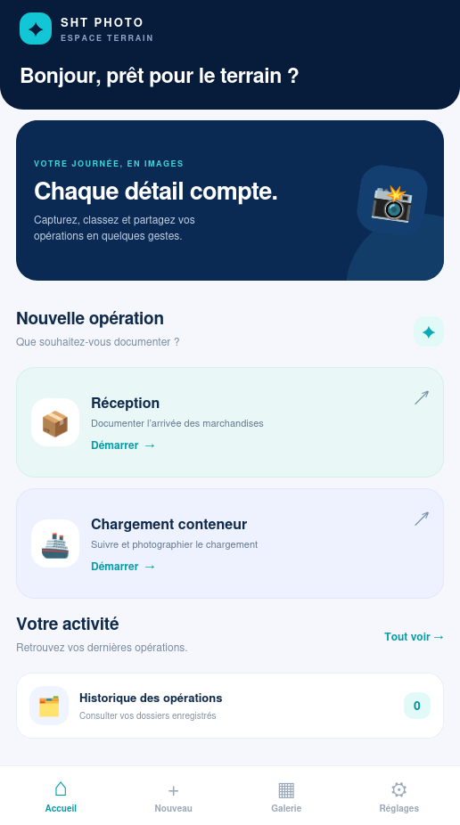
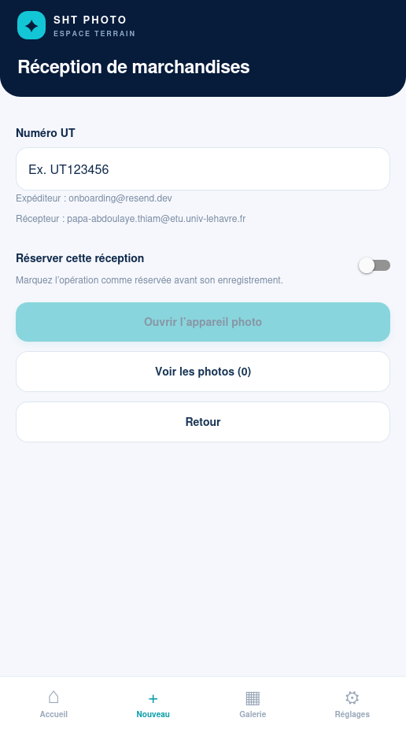
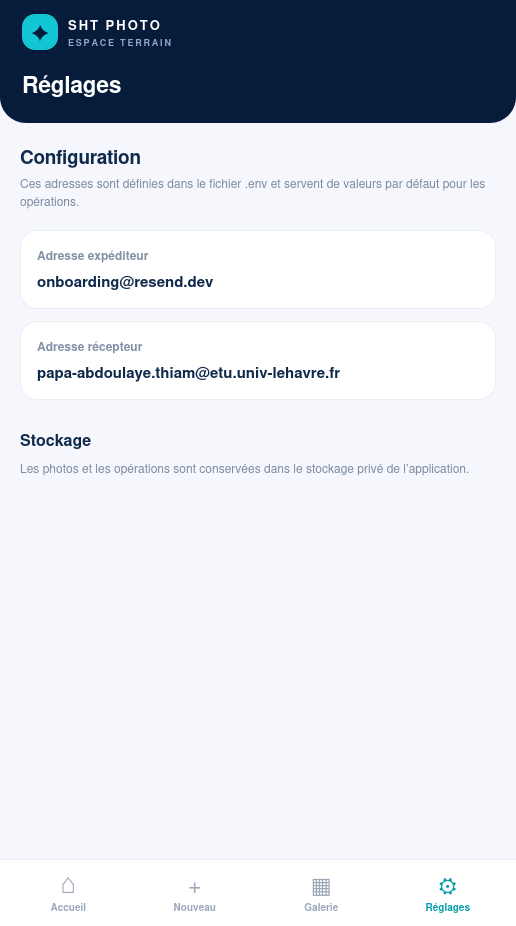

# SHT Photo — application Android

Prototype de départ React Native / Expo / TypeScript pour la SHT.

## Prérequis

- Node.js LTS
- npm
- Android Studio (pour un émulateur) ou un smartphone Android
- Expo Go pour les premiers tests, ou un development build si une bibliothèque l'exige

## Installation

```bash
npm install
npx expo start
```

Les adresses par défaut sont définies dans `.env` :

```env
EXPO_PUBLIC_SENDER_EMAIL=sht@example.com
EXPO_PUBLIC_RECIPIENT_EMAIL=client@example.com
```

Copiez `.env.example` pour créer votre propre configuration. Avec Expo, les variables
préfixées par `EXPO_PUBLIC_` sont intégrées dans l'application ; elles ne doivent donc
pas contenir de mot de passe ou de secret.

Scannez le QR code avec Expo Go ou lancez l'émulateur Android avec `a`.

Vérifications locales :

```bash
npm run typecheck
npx expo export --platform android
```

## Organisation du code

- `App.tsx` : point d'entrée Expo et orchestration des écrans.
- `src/types.ts` : modèles TypeScript des opérations et des photos.
- `src/constants.ts` : configuration et catégories métier.
- `src/services/operations.ts` : persistance de l'historique avec AsyncStorage.
- `src/services/photos.ts` : nommage, copie et suppression des photos.

## Fonctionnalités incluses dans ce prototype

- Accueil avec réception ou chargement de conteneur
- Saisie d'un numéro UT ou de conteneur
- Appareil photo intégré
- Nommage automatique des photos
- Stockage des photos dans le répertoire privé de l'application
- Galerie avec suppression
- Prise de plusieurs photos par opération et visualisation dans une galerie
- Option « Réserver » pour les réceptions
- Page d'aperçu et de confirmation avant l'enregistrement local
- Choix entre confirmation d'envoi e-mail (en attente localement) et brouillon
- Recherche instantanée dans l'historique
- Ouverture des photos en plein écran depuis les galeries et les détails
- Menu inférieur avec Accueil, Nouvelle opération, Galerie et Réglages
- Brouillons et historique local
- Écran de détail et consultation des photos enregistrées
- Fonctionnement local possible sans API ; l'envoi Outlook devient disponible lorsque le backend est configuré
- Conservation locale des métadonnées dans AsyncStorage et des fichiers photo dans le stockage privé de l'application

## Limites du prototype

- Les photos et l'historique sont stockés uniquement sur le téléphone ; la désinstallation de l'application ou l'effacement de ses données les supprime.
- Il n'y a pas de synchronisation entre appareils ni de sauvegarde distante.
- Sans backend configuré, aucun e-mail n'est envoyé et le statut `EN_ATTENTE`
  signifie uniquement que l'opération est prête à être envoyée. Avec le backend
  Outlook configuré, le statut devient `ENVOYE` lorsque Microsoft Graph accepte le
  message ; le destinataire peut être une adresse Gmail.

## Envoi Resend sécurisé pour les tests
Le backend optionnel se trouve dans `server/`. Il utilise l'API Resend ; la clé
Resend et l'adresse expéditeur ne sont jamais embarquées dans l'application mobile.

```bash
cp server/.env.example server/.env
npm install
npm run server:build
npm run server:start
```

Dans Resend, vérifiez l'adresse ou le domaine expéditeur et renseignez
`RESEND_API_KEY` et `RESEND_FROM_EMAIL` dans `server/.env`. Avec le domaine de test
Resend, l'envoi peut être limité aux destinataires autorisés par Resend.
Le serveur doit être exposé uniquement en HTTPS en production,
derrière un reverse proxy, et `API_SHARED_TOKEN` doit être généré aléatoirement avec
au moins 32 caractères.
L'application mobile utilise `EXPO_PUBLIC_MAIL_API_URL` et
`EXPO_PUBLIC_MAIL_API_TOKEN` pour appeler ce serveur. Ce token est un mécanisme
de protection du prototype, pas un secret inviolable dans une application mobile ;
une authentification utilisateur (OAuth/OIDC) est recommandée avant production.
- Le code doit être testé sur les appareils Android cibles avant utilisation en production.

### Exécution avec Docker

Docker sert à exécuter le backend Outlook de manière reproductible. L'application
Expo et l'émulateur Android restent exécutés hors du conteneur.

```bash
cp server/.env.example server/.env
# Renseignez les identifiants Azure et le token dans server/.env
npm run docker:build
npm run docker:up
```

Le backend est alors disponible sur `http://localhost:8787` et son état peut être
vérifié avec :

```bash
curl http://localhost:8787/health
docker compose ps
docker compose logs -f mail-api
```

Pour arrêter le backend :

```bash
npm run docker:down
```

L'image utilise un build multi-étapes, un utilisateur non privilégié, un système de
fichiers en lecture seule et ne reçoit aucun secret dans l'image. Les secrets sont
fournis uniquement au démarrage via `server/.env`, qui ne doit jamais être commit.

## Convention de nommage

Réception : `NUMERO_UT_AAAAMMJJ_HHMMSS_INDEX.jpg`

Conteneur : `NUMERO_CONTENEUR_AAAAMMJJ_HHMMSS_CATEGORIE_INDEX.jpg`
## Aperçu des écrans
<figcaption style="text-align: center; font-style: italic;">Aperçu des écrans de l'application</figcaption>
  
  
  
  <!--  -->
  <!--  -->
  
</figcaption>

## Auteurs
- Papa THIAM